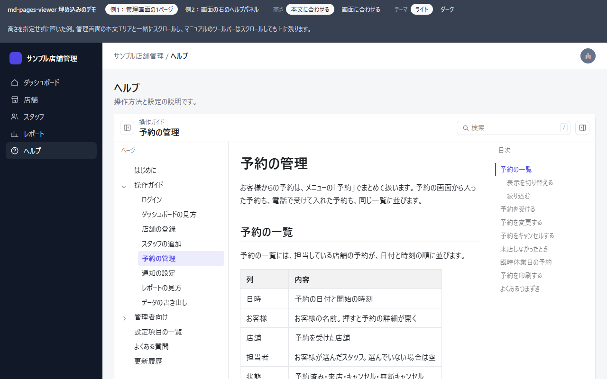
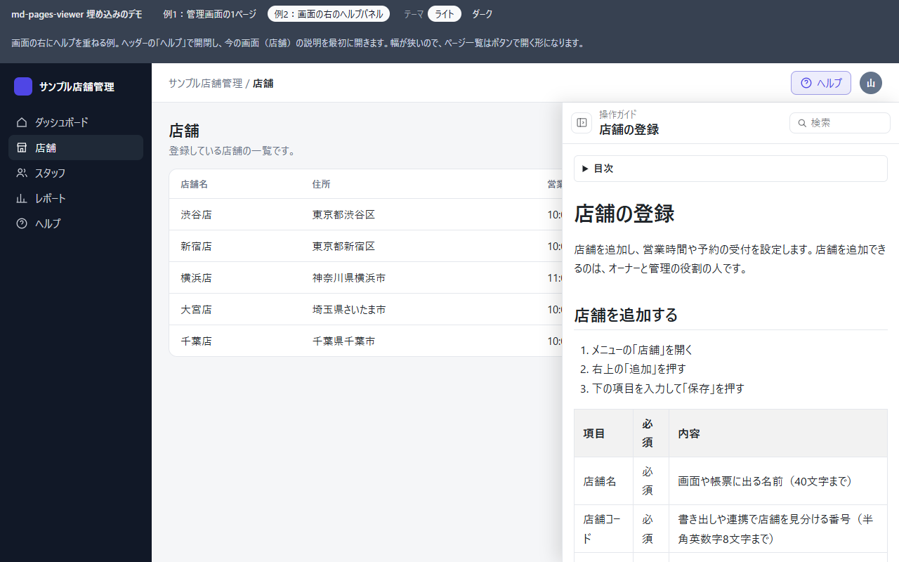

# md-pages-viewer

[](https://www.npmjs.com/package/md-pages-viewer)
[](https://github.com/koutakagatsume/md-pages-viewer/blob/main/LICENSE)

階層のある Markdown 文書をブラウザで表示するライブラリです。`<script>` を1行読み込むだけで、サーバー側の言語を問わず組み込めます。業務アプリや管理画面の中に、操作マニュアルやヘルプを置く使い方を想定しています。

**デモ：<https://koutakagatsume.github.io/md-pages-viewer/>**（架空の店舗管理アプリに組み込んだ例）



- ページのデータから、上のツールバー（今の場所・検索欄）・サイドバー・ページ内目次・前後のページへのリンクを自動で作ります
- 本文は Markdown 文字列でも、md ファイルの URL（S3、サーバーのストレージ）でも渡せます
- 表示は Shadow DOM の中に作るので、組み込み先の CSS と互いに影響しません
- 表示する HTML はすべて DOMPurify でサニタイズします

データの保存やページ一覧を返す API は、利用側で用意します。下の[ページのデータ](#ページのデータ)の形で返せば、DB の種類やテーブル構造は問いません。

## どんなときに使うか

- 業務アプリや管理画面に、操作マニュアルやヘルプを組み込みたいとき
- マニュアルの本文を DB や S3 に置き、アプリを再デプロイせずに書き換えたいとき
- 開いている画面の説明を、その画面からすぐ開きたいとき（`currentId` で開くページを指定します）

VitePress や Docusaurus のような静的サイトジェネレーターは、Markdown からマニュアル用の別のサイトを作ります。md-pages-viewer は、今あるアプリの画面の中に置き、ページのデータを実行時に受け取って表示します。



## デモ

| デモ | 内容 |
| --- | --- |
| [埋め込みの例](https://koutakagatsume.github.io/md-pages-viewer/demo/embed.html) | 架空の店舗管理アプリに組み込んだ例。左のメニューの「ヘルプ」では管理画面の1ページに、ほかの画面ではヘッダーの「ヘルプ」で右のヘルプパネルにマニュアルを出します。中身はこのライブラリの使い方と、店舗管理のマニュアルの例です。テーマ（ライト・ダーク）と高さの指定を切り替えられます。ヘッダーの右上で、言語（日本語・英語・中国語の簡体字と繁体字・韓国語）も切り替えられます |
| [タグで置いた例](https://koutakagatsume.github.io/md-pages-viewer/demo/index.html) | このライブラリの説明を表示します。ページの一覧を JSON の URL で渡し、本文の多くは md ファイルの URL で渡しています |
| [`new MdPagesViewer()` の例](https://koutakagatsume.github.io/md-pages-viewer/demo/new.html) | 高さを指定した枠に入れた例。サイドバー・本文・目次がそれぞれの中でスクロールします |
| [CDN から読み込む例](https://koutakagatsume.github.io/md-pages-viewer/demo/cdn.html) | 1つの HTML ファイルで完結する例。ダウンロードして、そのまま開いても動きます |

## 読み込み

CDN から読み込みます。

```html
<script src="https://cdn.jsdelivr.net/npm/md-pages-viewer@1/dist/md-pages-viewer.js"></script>
```

外部の CDN に接続できない環境では、`md-pages-viewer.js` を自分のサーバーに置いて読み込みます。CSS はこのファイルに含まれているので、`<link>` は要りません。ファイルの大きさは約151KB（gzip で約48KB）で、Markdown の変換（marked）とサニタイズ（DOMPurify）を含みます。

ビルドするプロジェクトでは npm からインストールします。

```bash
npm install md-pages-viewer
```

```js
import { MdPagesViewer } from 'md-pages-viewer';
```

`import` するだけで `<md-pages-viewer>` タグも使えるようになります。

## 使い方

タグで置きます。

```html
<md-pages-viewer pages="/api/manual/pages" current-id="intro"></md-pages-viewer>
```

配列・関数・オブジェクト（`texts`）は、JS で要素のプロパティに設定します。

```js
const viewer = document.querySelector('md-pages-viewer');
viewer.imageResolver = (path) => `/api/manual/image?path=${encodeURIComponent(path)}`;
```

`new` でも作れます。指定した要素の中身が置き換わります。

```js
const viewer = new MdPagesViewer('#manual', {
  pages: '/api/manual/pages',
  currentId: 'intro',
});

// 表示後のオプションの変更は element のプロパティで
viewer.element.currentId = 'faq';
```

## ページのデータ

ページはフラットな配列で渡し、`parentId` で階層を表します。`pages` に URL を渡す場合は、この配列そのものを JSON で返します。

| 項目 | 型 | 必須 | 内容 |
| --- | --- | --- | --- |
| `id` | string / number | 必須 | ページの一意な ID |
| `parentId` | string / number / null | 必須 | 親ページの ID。最上位は null |
| `title` | string | 必須 | パンくず・サイドバーに表示する名前 |
| `description` | string | 任意 | 子ページ一覧と検索の結果に出す説明文 |
| `thumbnail` | string | 任意 | 子ページ一覧をカードの形にしたとき、カードの上に出す画像のパスまたは URL |
| `md` | string | 任意 | 本文の Markdown |
| `src` | string | 任意 | md ファイルの URL |
| `order` | number | 任意 | 同じ階層内の並び順（小さい順）。未指定のページは指定したページの後に配列の順で並ぶ |

`md` も `src` もないページは、本文の代わりに、直下の子ページの一覧を表の形で並べます。カテゴリのように子ページをまとめる親ページに使えます。各行には子ページの名前、`description`（2行まで）、章の数（`md` の h2 の数）または子ページの数が出ます。ツールバーのボタンでカードの形にも切り替えられます。カードの形では、`thumbnail` を指定したページのカードの上に、その画像を横長（16:9）で出します。`thumbnail` は本文の画像と同じ規則で解決し（下の「画像とリンク」）、`imageResolver` を指定していればそれを通します。画像は画面に近づいたときに読み込み、表の形では読み込みません。`src` のページは一覧のために本文を取得しません。

```json
[
  { "id": "intro", "parentId": null, "title": "はじめに", "md": "# はじめに", "order": 1 },
  { "id": "login", "parentId": "intro", "title": "ログイン方法", "src": "/storage/manual/login.md", "order": 1 },
  { "id": "faq", "parentId": null, "title": "FAQ", "src": "https://xxx.s3.amazonaws.com/manual/faq.md", "order": 2 },
  { "id": "guide", "parentId": null, "title": "操作ガイド", "order": 3 },
  { "id": "guide-start", "parentId": "guide", "title": "始め方", "description": "最初に行う設定の流れ", "md": "# 始め方", "order": 1 }
]
```

`src` のページは開いたときに初めて取得し、画面を再読み込みするまで保持します。

## 画面

- 上のツールバーに、サイドバーを開閉するボタン（左端）、今の場所（上の階層と今のページの名前）、検索欄、ページ内目次を開閉するボタン（右端）が並びます。子ページ一覧のページでは、右端が表とカードの切り替えボタンになります
- 検索欄では、ページ名・`description`・見出し・本文を探せます。全角・半角、大文字・小文字は区別せず、空白で区切った語はすべてを含むものが出ます。結果は検索欄の下に出て、押すとそのページの見出しの位置へ移動します。`/` キーで検索欄に移り、↑↓ と Enter で結果を選べます。本文は検索欄に入ったときから少しずつ読むので、ページが多くても画面は止まりません。読み終えるまでは読んだページの分から結果を出し、「検索しています…」と表示します。`src` のページは、検索のために本文を取得せず、ページ名と `description` だけが対象です
- ページ内目次は、読んでいる見出しをスクロールに合わせて強調し、h3 は読んでいる章の分だけを並べます。目次で選んだ見出しへは、なめらかにスクロールして移ります。移る間も、選んだ見出しを強調したままにします。着いたら、その見出しの文字と下線が強調色になって、1.5秒ほどで元に戻ります（途中で自分でスクロールしたときは付きません）。目次で選んだ見出しは、本文が短くて上端まで来られないときも強調されます
- 本文の最後（子ページ一覧のページでは一覧の下）に、サイドバーの順で前と次のページへのリンクが出ます
- サイドバーと目次の開閉、サイドバーの子ページの開閉には短い動きが付きます（広い表示幅では列の幅が変わり、狭い表示幅ではサイドバーが要素の左端から滑り出ます。子ページの並びは高さが伸び縮みします。ページ名を押して子ページが開くときも同じです）。OS やブラウザで動きを減らす設定にしている利用者には付けず、目次で選んだ見出しへもすぐ移り、着いた見出しも示しません
- 組み込み先のページが日本語（`<html lang="ja">` など）なら、見出し・表のセル・ページ一覧の項目などを文節の切れ目で折り返し、「必須」「店舗コード」のような短い言葉を途中で折りません（Chrome・Edge。Safari・Firefox では通常の折り返し）。本文の段落は通常の折り返しのままです
- 組み込み先のページが中国語（`<html lang="zh-CN">`・`<html lang="zh-TW">` など）なら、本文の表で、空白を除いて6文字までのセルを折り返さず、「必填」「电话号码」のような短い言葉を途中で折りません。それより長いセルは、これまでどおり字の単位で折り返します
- 幅に収まらない表は、本文全体ではなく表の中だけが横にスクロールします

## オプション

| オプション | タグの属性 | 型 | 内容 |
| --- | --- | --- | --- |
| `pages` | `pages`（URL のみ） | 配列 / URL | ページのデータ、またはそれを返す URL |
| `currentId` | `current-id` | string / number | 表示するページの ID。最初の表示では URL の `?page=` を優先します。表示後に設定するとそのページに切り替わります |
| `baseUrl` | `base-url` | string | `md` のページの相対パスの基準。未指定時は組み込み先ページの URL |
| `imageResolver` | なし | 関数 | 画像のパスとページのデータを受け取り、表示用の URL を返す関数 |
| `fetch` | なし | 関数 | 一覧と本文の取得に使う関数（ブラウザの `fetch` と同じ引数・戻り値）。別オリジンの API に Cookie や認証ヘッダーを付けるときに使います |
| `urlParam` | `url-param` | string / false | URL に反映するクエリの名前（初期値 `page`）。`false` で反映しません |
| `styles` | なし | string | 表示領域の中に追加する CSS（「見た目の変更」を参照） |
| `locale` | `locale` | string | 画面の文言の言語（初期値 `ja`）。「画面の言語と文言」を参照 |
| `texts` | なし | オブジェクト | 画面の文言を1つずつ置き換えます。「画面の言語と文言」を参照 |

`fetch` や `imageResolver` を使う場合は、`pages` を属性ではなくプロパティで、それらより後に設定してください。

## md ファイルの置き場所

| 保存場所 | 利用側で必要な対応 |
| --- | --- |
| S3（公開バケット） | CORS 設定（組み込み先のオリジンからの GET を許可） |
| S3（非公開バケット） | CORS 設定に加えて、サーバー側で署名付き URL を発行して `src` に渡す。期限があるため、ページ一覧を返すたびに発行する |
| サーバーのストレージ | ブラウザからアクセスできる URL にする（Laravel なら `storage:link`、または認証付きルート） |

`pages` を URL で渡している場合、本文の取得に失敗すると一覧を取得し直して1回だけ取得し直します。署名付き URL の期限が切れていても表示を続けられます。

## 画像とリンク

相対パスの画像は、`src` のページでは md ファイルの場所を、`md` のページでは `baseUrl` を基準にします。

非公開の S3 では、署名付き URL を基準にすると署名の部分が外れて表示できません。`imageResolver` で利用側の API を経由させてください。`blob:` の URL を返すこともできます。

本文のリンクは次のように動きます。

| 書き方 | 動き |
| --- | --- |
| `?page=ID`、`?page=ID#見出しID` | このライブラリの中でページを切り替える |
| `#見出しID` | このページの見出しへスクロールする |
| md ファイルの相対パス（`login.md` など） | `src` と一致すれば、そのページに切り替える |
| そのほかの相対パス | `src` または `baseUrl` を基準に解決した URL へ移動する |
| 組み込み先とオリジンが異なる URL | 新しいタブで開く |

## 注意・ヒントの囲み

引用（`>`）の1行目に種類を書くと、その引用が色付きの枠になります。書き方は GitHub の Markdown と同じです。

```markdown
> [!WARNING]
> 1枠の長さを変えても、すでに入っている予約はそのまま残ります。
```

| 書き方 | 見出し（日本語のとき） | 色の CSS 変数（初期値） |
| --- | --- | --- |
| `[!NOTE]` | 補足 | `--mpv-color-note`（`#2563eb`） |
| `[!TIP]` | ヒント | `--mpv-color-tip`（`#16a34a`） |
| `[!IMPORTANT]` | 重要 | `--mpv-color-important`（`#7c3aed`） |
| `[!WARNING]` | 注意 | `--mpv-color-warning`（`#b45309`） |
| `[!CAUTION]` | 警告 | `--mpv-color-caution`（`#dc2626`） |

- 種類は大文字・小文字のどちらでも書けます。印（`[!NOTE]` など）の行には、ほかの文字を書きません
- 2行目からは、段落・箇条書き・表・リンクなど、ふつうの Markdown が書けます
- 知らない種類や、印の行にほかの文字がある場合は、ふつうの引用のまま表示します
- 色の初期値は白い背景で読みやすい色です。組み込み先の画面がダークのときは、明るめの色を指定してください

```css
[data-theme='dark'] md-pages-viewer {
  --mpv-color-note: #60a5fa;
  --mpv-color-tip: #4ade80;
  --mpv-color-important: #a78bfa;
  --mpv-color-warning: #fbbf24;
  --mpv-color-caution: #f87171;
}
```

## 画面の言語と文言

ボタンや検索欄などの文言の言語は、`locale` で選べます。日本語（`ja`、初期値）・英語（`en`）・中国語の簡体字（`zh-CN`）・繁体字（`zh-TW`）・韓国語（`ko`）が入っています。`locale` を指定するだけで、ボタンなどの文言はすべてその言語のものになります。`texts` は、変えたい文言があるときだけ使います。

```html
<md-pages-viewer pages="/api/manual/pages" locale="en"></md-pages-viewer>
```

`en-US` や `zh-Hant` のような書き方でも選べます。入っていない言語を指定すると、日本語で表示してコンソールに警告を出します。

文言は `texts` で1つずつ変えられます。書いたものだけが変わり、ほかは `locale` の言語のままです。数などを出す文言は、それを受け取る関数で書きます。

```js
viewer.texts = {
  search: '検索する！',
  chapters: (n) => `全${n}章`,
};
```

| キー | 使う場所 | 日本語の文言 |
| --- | --- | --- |
| `loading`・`failed`・`retry` | 読み込み中・読み込めなかったときの表示と、再読み込みのボタン | 読み込み中…・読み込めませんでした・再読み込み |
| `notFound`・`noPages` | 存在しないページ・ページが1つもないときの表示 | ページが見つかりません・ページがありません |
| `pageList` | サイドバーの読み上げ用の名前 | ページ一覧 |
| `columnPages`・`columnContent` | サイドバーの見出し、子ページ一覧の表の見出しの行 | ページ・内容 |
| `toc` | ページ内目次の見出し | 目次 |
| `breadcrumb` | パンくずの読み上げ用の名前 | パンくずリスト |
| `toggle` | サイドバーの開閉ボタンの読み上げ用の名前（関数。ページ名を受け取る） | （ページ名） 開閉 |
| `chapters`・`childPages` | 子ページ一覧の章の数・子ページの数（関数。数を受け取る） | N章・Nページ |
| `search`・`searchLabel` | 検索欄の薄い文字と、読み上げ用の名前 | 検索・ページを検索 |
| `searching` | 読み終えるまでの検索結果 | 検索しています… |
| `noResults` | 一致がないときの検索結果（関数。入力した語を受け取る） | 「（語）」に一致するページはありません |
| `sidebarClose`・`sidebarOpen` | サイドバーを閉じる・開くボタン | ページ一覧を閉じる・ページ一覧を開く |
| `tocClose`・`tocOpen` | 目次を閉じる・開くボタン | 目次を閉じる・目次を開く |
| `viewCard`・`viewList` | 子ページ一覧の形を切り替えるボタン | カード表示・一覧表示 |
| `pager`・`previous`・`next` | 前後のページ（読み上げ用の名前と、前・次の文字） | 前後のページ・前へ・次へ |
| `calloutNote`・`calloutTip`・`calloutImportant`・`calloutWarning`・`calloutCaution` | 注意・ヒントの囲みの見出し | 補足・ヒント・重要・注意・警告 |

- 表示した後に `locale` や `texts` を変えると、ページとスクロール位置はそのままで、文言がすぐ変わります。`texts` を変えるときは、新しいオブジェクトを設定してください
- 表にないキーや、関数のはずの文言に文字列を書いたものは、コンソールに警告を出して使いません
- ページの名前と本文は訳しません。言語を切り替えるときは、`locale` と一緒にその言語のページのデータを `pages` に渡してください。言語を切り替えるボタンは、組み込み先の画面に置きます

## URL への反映

ページを切り替えると、組み込み先の URL のクエリ `page` が切り替え先の ID になり、履歴に追加されます。ブラウザの戻る・進むとリンクの共有がそのまま使えます。ほかのクエリは書かれたまま残ります。

組み込み先が `page` を使っている場合は `urlParam` で名前を変えてください。同じ画面に2つ置く場合や、組み込み先が URL の `#` で画面を切り替えている場合は `urlParam` を `false` にしてください。

## 見た目の変更

次の CSS 変数で上書きできます。文字色とフォントは、指定しなければ組み込み先の設定を引き継ぎます。

| CSS 変数 | 内容 |
| --- | --- |
| `--mpv-font-family` | フォント |
| `--mpv-font-size` | 本文の文字の大きさ（初期値 16px） |
| `--mpv-color-text` | 文字色 |
| `--mpv-color-bg` | 背景色。指定しないと、表示領域は透明で、上に残るツールバーや重ねて出す部品はブラウザの既定の背景色（白など）になります。組み込み先の背景が白以外なら指定してください |
| `--mpv-color-accent` | リンクと現在のページの強調色 |
| `--mpv-color-border` | 区切り線の色 |
| `--mpv-sidebar-width` | サイドバーの幅 |
| `--mpv-spacing` | 余白の基準の大きさ |
| `--mpv-color-note` ほか4つ | 注意・ヒントの囲みの色（下の「注意・ヒントの囲み」を参照） |

```css
md-pages-viewer {
  --mpv-color-accent: #8250df;
  --mpv-sidebar-width: 300px;
}
```

### 部品ごとの見た目（`::part()`）

部品には次の part 名が付いていて、組み込み先の CSS から `::part()` で見た目を変えられます。本ライブラリの CSS より優先されます。

| part 名 | 部品 |
| --- | --- |
| `toolbar` | 上のツールバー |
| `sidebar-toggle` | ツールバーの左端の、サイドバーを開閉するボタン |
| `breadcrumb` | パンくず（今の場所） |
| `breadcrumb-item` | パンくずの各ページ。現在のページには `current` も付きます |
| `search` | 検索欄と結果を囲む場所 |
| `search-input` | 検索欄 |
| `search-results` | 検索の結果の場所 |
| `search-result` | 検索の各結果のリンク |
| `search-mark` | 検索の結果の、一致した部分の印 |
| `search-empty` | 一致がないとき・検索中（「検索しています…」）の表示 |
| `toc-toggle` | ツールバーの右端の、ページ内目次を開閉するボタン |
| `view-toggle` | ツールバーの右端の、子ページ一覧の表とカードを切り替えるボタン |
| `sidebar` | サイドバー |
| `page-link` | サイドバーの各ページのリンク。現在のページには `current` も付きます |
| `toggle` | サイドバーの子ページの開閉ボタン |
| `main` | 中央の列（本文・前後のページ） |
| `content` | 本文の場所 |
| `toc` | ページ内目次 |
| `toc-mobile` | 狭い表示幅で本文の上に出すページ内目次 |
| `toc-link` | ページ内目次の各見出しのリンク。`toc-h2`・`toc-h3`、読んでいる見出しには `current` も付きます |
| `child-list-head` | 子ページ一覧の表の見出しの行 |
| `child-list` | 子ページ一覧 |
| `child-link` | 子ページ一覧の各ページ（表の行・カード） |
| `child-thumbnail` | カードの上の子ページの画像（`thumbnail`） |
| `child-title` | 子ページの名前 |
| `child-description` | 子ページの説明文 |
| `child-meta` | 子ページの章の数・子ページの数 |
| `callout` | 本文の注意・ヒントの囲み。`note`・`tip`・`important`・`warning`・`caution` も付きます |
| `callout-title` | 注意・ヒントの囲みの見出し |
| `target-heading` | 目次で選んで移った本文の見出し。文字と下線が強調色になっている間だけ付きます。`::part(target-heading)` で動きを消したときも、1.5秒ほどで外れます |
| `pager` | 本文の最後の前後のページ |
| `pager-link` | 前後のページの各リンク。前は `previous`、次は `next` も付きます |
| `status` | 読み込み中・エラーの表示 |
| `retry-button` | 再読み込みボタン |

```css
md-pages-viewer::part(sidebar) {
  background: #f6f8fa;
}

md-pages-viewer::part(page-link current) {
  font-weight: 700;
}

md-pages-viewer::part(toolbar) {
  background: #f6f8fa;
}
```

### 本文の見た目（`styles`）

`::part()` は部品そのものにだけ効き、本文の見出しや表などは選べません。本文の見た目は、`styles` に CSS を文字列で渡して変えます。渡した CSS は表示領域の中にだけ効き、詳細度によらず本ライブラリの CSS より優先されます。要素は part 名から指定してください（クラス名は変わることがあります）。

```js
const viewer = document.querySelector('md-pages-viewer');
viewer.styles = `
  [part~="content"] h1 { font-size: 2.2em; }
  [part~="content"] th { background: #eef2ff; }
  [part~="content"] a { text-decoration: none; }
`;
```

`new MdPagesViewer('#manual', { pages, styles })` のように、`new` のオプションでも渡せます。style-src に `'unsafe-inline'` がない CSP のページでも効きます。

`styles` の CSS はサニタイズせずにそのまま使います。利用者が入力した文字列や DB の値など、自分で書いていない CSS は渡さないでください（部品を隠したり、別の部品に見せたり、`url()` で外部の画像を読み込んだりできるため）。

要素の高さを指定しなければ本文に合わせて伸び、スクロールしてもツールバーは画面の上に、サイドバーと目次はその下に残ります。高さを指定すると、ツールバーの下で、サイドバー・本文・目次がそれぞれの中でスクロールします。要素の幅が 768px 未満になると、サイドバーはツールバーのボタンで本文の上に開く形になり、目次は本文の上に折りたたまれます。

## セキュリティ

Markdown を変換した HTML は、画面に入れる前に DOMPurify でサニタイズします。スクリプトの実行につながるものに加えて、次のものも除去します。

- `<style>`、`<form>`、`<dialog>`、`<slot>`、`popover` などの属性（組み込み先の画面に影響するため）
- `imageResolver` を通らずに画像を読み込むもの（`poster`・`background` 属性、CSS の `url()` を含む `style` 属性など）

`styles` で渡す CSS はサニタイズしません（[本文の見た目](#本文の見た目styles)を参照）。

Content Security Policy を使うページでも動きます。

- `style-src` に `'unsafe-inline'` がなくても CSS は効きます
- Trusted Types を強制するページでは、`md-pages-viewer` という名前のポリシーを1つ使います。`trusted-types` ディレクティブで許可する名前を限定している場合は、この名前を追加してください

```text
Content-Security-Policy: require-trusted-types-for 'script'; trusted-types md-pages-viewer
```

## 開発

```bash
npm install
```

```bash
npm run build
```

```bash
npm test
```

```bash
npm run serve
```

`npm run serve` のあと、<http://localhost:4173/demo/> でデモを確認できます。ブラウザのテストは Playwright でインストール済みの Microsoft Edge を使います。Firefox と Safari では確かめていません。

## ライセンス

MIT License。Copyright (c) 2026 Kota Kagatsume

同梱している marked と DOMPurify のライセンスは `dist/THIRD_PARTY_LICENSES.txt` にあります。
