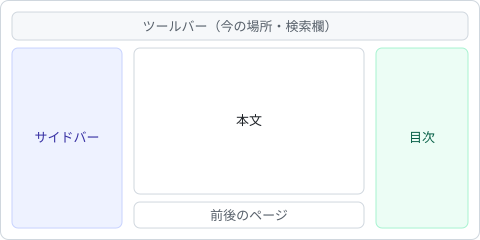

# 画像とリンク

## 画像

相対パスの画像は、mdファイルの場所を基準に表示します。

非公開のストレージに置いた画像は、`imageResolver` で利用側のAPIを経由させます。

## リンク

| 書き方 | 動き |
| --- | --- |
| `?page=ID` | このライブラリの中でページを切り替える |
| `#見出し` | このページの見出しへ移動する（[例：外部リンク](#外部リンク)） |
| mdファイルの相対パス | そのページに切り替える（[オプション](options.md#URLへの反映)） |
| 別のサイトのURL | 新しいタブで開く |

## 外部リンク

[marked](https://github.com/markedjs/marked) と [DOMPurify](https://github.com/cure53/DOMPurify) を使っています。
