# 危険な本文

クリックする場所

[mdのjavascriptリンク](javascript:window.__xssMdLink=1)

<a id="html-js" href="javascript:window.__xssHtmlLink=1">HTMLのjavascriptリンク</a>

<a id="mixed-js" href="JaVaScRiPt:window.__xssMixed=1">大文字小文字混在のjavascriptリンク</a>

残りの本文

